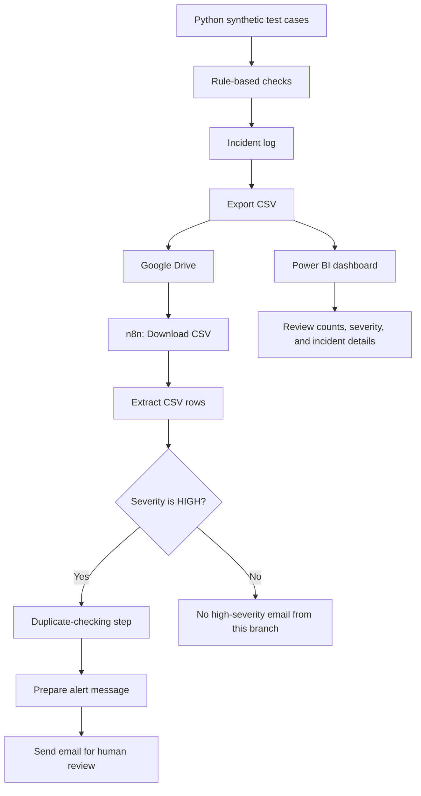

# AI-AGENT-WATCHDOG
AI-agent incident monitoring proof of concept using Python, Power BI, n8n, and email alerts.

# AI Agent Watchdog

**A portfolio proof of concept for AI-agent incident monitoring,
reporting, and escalation.**

The AI Agent Watchdog explores how a lightweight monitoring workflow
could help make potential AI-agent output issues easier to identify,
review, and track. It combines Python-based checks, CSV incident
logging, Power BI reporting, and n8n email automation.

> **Project status:** Proof of concept using synthetic data. It does not
> currently monitor a live AI agent, independently diagnose failures
> with an LLM, or automatically repair production systems.

## Table of Contents

-   [Why I Built This](#why-i-built-this)
-   [Project Goals](#project-goals)
-   [How It Works](#how-it-works)
-   [Workflow Diagram](#workflow-diagram)
-   [Tools and Technologies](#tools-and-technologies)
-   [Incident Examples](#incident-examples)
-   [Dashboard and Alerts](#dashboard-and-alerts)
-   [Current Scope and Limitations](#current-scope-and-limitations)
-   [Future Improvements](#future-improvements)
-   [What This Project Demonstrates](#what-this-project-demonstrates)
-   [Repository Contents](#repository-contents)
-   [Disclaimer](#disclaimer)

## Why I Built This

AI assistants and agents can help automate work, but their outputs still
need appropriate checks. For example, a response may be incorrect, lack
an expected citation, or contain a citation that does not support the
answer. If those issues are difficult to see, teams may have to inspect
outputs manually or rely on users to report problems.

I built this project after exploring practical AI applications and
workflow optimization. The goal was to create a small, testable example
of how potential failures could be recorded, prioritized, visualized,
and routed for human review.

This is a portfolio project intended to demonstrate a problem-solving
approach. It does not assume that a particular organization or software
platform has a confirmed gap.

## Project Goals

1.  Create sample test cases representing different AI-agent output
    outcomes.
2.  Apply simple, rule-based checks to identify selected issue types.
3.  Record flagged incidents in a structured CSV file.
4.  Visualize incidents and their severity in Power BI.
5.  Use n8n to process incident records and filter high-severity cases.
6.  Send an email alert that prompts a person to review a high-severity
    incident.
7.  Identify possible next steps for a more robust, live monitoring
    solution.

## How It Works

### 1. Generate and evaluate sample cases with Python

Python is used to work with synthetic test cases representing scenarios
such as:

-   An acceptable answer
-   An incorrect answer
-   An answer missing an expected citation
-   An answer containing an incorrect or unexpected citation

Rule-based checks flag selected cases and assign a severity for
demonstration purposes. Flagged results are stored in an incident log
and exported to CSV.

**Important:** These checks are illustrative rules. They do not
establish the truth of arbitrary AI-generated answers, and the data is
not from a live production agent.

### 2. Store incident records in CSV

The CSV file acts as a simple handoff between the Python analysis and
the downstream tools. It contains incident details such as identifiers,
issue descriptions, severity, status, and suggested review actions,
depending on the available fields.

### 3. Visualize incidents in Power BI

The Power BI dashboard provides a way to inspect the sample incident
records. It includes views such as:

-   Incident count and severity summary
-   Incidents by severity or test category
-   An incident detail table
-   Filters for reviewing selected severity or status values

The dashboard is intended to help a reviewer quickly understand what has
been flagged. Any status or resolution labels created using
demonstration rules should be interpreted as prototype fields, not proof
that an incident has actually been resolved.

### 4. Process incidents in n8n

The current automation workflow uses the CSV stored in Google Drive as
its input:

1.  A manual trigger starts a test run.
2.  Google Drive downloads the CSV file.
3.  The Extract From File node parses the CSV rows into records.
4.  An IF node checks the `Severity` field and routes high-severity
    records.
5.  The high-severity branch applies the configured duplicate-checking
    step.
6.  An Edit Fields step prepares a human-review message.
7.  An email node sends the alert.

The current tested flow is designed around sample data and email
escalation. Whether duplicates are suppressed across separate workflow
executions depends on the exact deduplication configuration; reliable
cross-run incident tracking would require persistent state or storage
designed for that purpose.

### 5. Send an email alert

For records routed through the high-severity branch, the workflow sends
an email containing available incident details and a message that human
review is required. This reduces the need to watch the dashboard
continuously during a test run.

The notification is a rule-based template, not an LLM-generated
diagnosis. The alert should be treated as a prompt to investigate---not
as a verified root cause or an automatic fix.

## Workflow Diagram

The diagram below describes the current proof-of-concept data path.
Power BI is a separate reporting view over the incident data.

## Tools and Technologies

  -----------------------------------------------------------------------
  Tool                                Role in the project
  ----------------------------------- -----------------------------------
  Python                              Works with synthetic test cases and
                                      applies rule-based checks

  CSV                                 Provides a simple, structured
                                      incident-data handoff

  Power BI                            Visualizes incident counts,
                                      severity, and record details

  Google Drive                        Stores the CSV used as n8n input

  n8n                                 Automates file processing,
                                      filtering, and email routing

  Email / Gmail SMTP                  Delivers human-review alerts
  -----------------------------------------------------------------------

## Incident Examples

The prototype explores how a monitoring workflow might handle examples
such as:

  -----------------------------------------------------------------------
  Example                 Potential issue         Illustrative response
  ----------------------- ----------------------- -----------------------
  Incorrect answer        The output fails a      Flag and prioritize for
                          defined test            review

  Missing citation        An expected reference   Log the issue for
                          is absent               review

  Unexpected citation     A reference does not    Log the issue for
                          match the expected      review
                          reference               

  Passing test            The output meets the    Retain the result for
                          defined sample check    evaluation
  -----------------------------------------------------------------------

These are test scenarios, not claims about failures in any company's AI
systems.

## Dashboard and Alerts

The Power BI dashboard and n8n email workflow serve different purposes:

-   **Power BI** supports investigation and trend review.
-   **n8n** routes selected records according to configured rules.
-   **Email** brings higher-priority sample incidents to a human
    reviewer.

Together, they demonstrate a basic path from a test result to a visible
record and an actionable notification.

## Current Scope and Limitations

### Implemented in this prototype

-   Synthetic AI-agent test scenarios
-   Rule-based flagging of selected issue types
-   Structured incident logging and CSV export
-   Power BI incident dashboard
-   n8n CSV ingestion and high-severity filtering
-   Email alert workflow tested with sample data

### Not yet implemented

-   Connection to a live or production AI agent
-   General-purpose semantic verification of answer correctness
-   LLM-based root-cause analysis
-   Automatic correction or repair of an agent
-   Reliable persistent incident state across workflow runs unless
    separately implemented and validated
-   Production-grade authentication, monitoring, access control, or
    audit processes

The prototype is not a security, compliance, or correctness guarantee.
Rules and severity thresholds would need to be validated against the
real use case before operational use.

## Future Improvements

Potential next steps include:

1.  **Connect an authorized test agent:** Collect outputs from a
    controlled environment rather than using only synthetic records.
2.  **Improve evaluation:** Add defined test suites, structured output
    checks, reference validation, and human-reviewed quality labels.
3.  **Track incidents persistently:** Store incident IDs and processing
    state in a database or other durable system to prevent repeated
    alerts across runs.
4.  **Add trend analysis:** Identify recurring issue types, failure
    rates, and changes over time.
5.  **Add diagnostic assistance:** Use an LLM to propose possible
    explanations, while clearly marking them as suggestions that need
    validation.
6.  **Test fixes safely:** Apply bounded, reversible changes in a
    sandbox, rerun relevant tests, and record whether the change passed.
7.  **Keep humans in control:** Require appropriate approval before
    changing live configurations or taking consequential actions.
8.  **Evaluate integration opportunities:** Review existing tools and
    workflows before deciding whether an additional monitoring layer
    would add value.

These are future possibilities, not features currently delivered by this
repository.

## What This Project Demonstrates

This project demonstrates a practical, end-to-end approach to a small
business-technology problem:

-   Breaking a broad idea into testable components
-   Using Python to structure and evaluate sample data
-   Creating a reporting view in Power BI
-   Connecting tools through workflow automation
-   Routing exceptions for human review
-   Testing the workflow and documenting limitations
-   Considering how a proof of concept could be improved before
    real-world adoption

## Repository Contents

The repository may include the following files as they are added:

-   `README.md` --- project overview and workflow
-   `AI_Agent_Watchdog_Project_Brief.pdf` --- concise project brief
-   `watchdog_analysis.ipynb` --- Python notebook, if included
-   `ai_agent_incidents.csv` --- synthetic incident records, if included
-   `AI_Agent_Watchdog.pbix` --- Power BI dashboard, if included
-   `workflow.png` --- workflow screenshot or diagram, if included

Only list files that are actually present in the repository. Do not
upload credentials, app passwords, tokens, confidential information, or
private company data.
